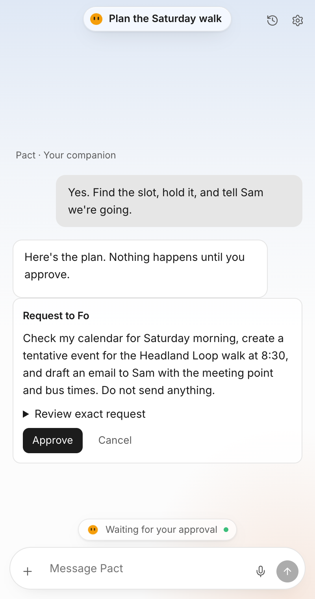

# Pact

**Talk it through with Claude. Let Fo do the next step. You approve everything.**

Pact is a Chrome side-panel companion. Open any page and ask about it — articles, GitHub, YouTube (with captions), even PDFs. Attach files, dictate, keep your chats. When a conversation turns into a task ("hold Saturday and tell Sam"), Pact proposes the exact request, and **nothing leaves your browser until you press Approve**. [Fo](https://wajo.ai) then carries it out across the tools you've connected: Gmail, Calendar, Drive, Slack, Figma, Notion, GitHub, and any MCP server.

<p align="center"></p>

## Try it (about a minute)

1. **Download** the latest [`pact-judges.zip`](https://github.com/labsbytito/pact/releases/latest) (also on the [website](https://pact-site-weld.vercel.app)).
2. **Unzip it** and keep the folder somewhere permanent.
3. Open `chrome://extensions`, switch on **Developer mode**, click **Load unpacked**, and choose the unzipped folder (the one containing `manifest.json`).
4. Pin Pact, open any web page, click the icon.

No terminal, API key or local server needed — the extension talks to the hosted backend. Chrome only allows one-click installs from the Web Store; a Store listing is in progress.

To act on real accounts, open **Settings → Connections → Connect Fo** and sign in with your own Fo account.

## What it does

| | |
|---|---|
| **Reads the web** | Page text, selections, a picked element, YouTube captions, PDFs (extracted locally with pdf.js) |
| **Chats** | Streaming Claude replies, Markdown, copy / retry / edit, files and images (drag, paste or +), dictation |
| **Remembers** | Pacts: pin, rename, archive, export as Markdown, delete (removes file contents) |
| **Acts safely** | Proposed request → you approve → Fo runs it → Pact shows the status Fo returned, never a guess |
| **Feels alive** | Companion characters that blink, glance, think, listen and settle |

## How it's built

```
extension (WXT + React, MV3)  ──HTTPS──▶  backend (Next.js on Vercel)  ──▶  Claude API
   side panel · page reader               install tokens · rate limits         │
   local chat storage                     daily AI budget · encrypted Fo       └─▶  Fo (MCP over OAuth)
```

- `entrypoints/`, `components/`, `hooks/`, `lib/` — the extension. Chats and files stay in `chrome.storage.local`.
- `backend/` — stateless API: per-install tokens, per-IP and per-install rate limits, a daily spend cap, AES-encrypted Fo credentials, an action journal with idempotency, and a policy layer that gates anything consequential.
- `website/` — the static marketing site and download page (`release.json` controls the download button).
- `scripts/` — `live-smoke.mjs` (verifies the live backend end to end), `release.mjs` (build, package, publish the ZIP), `package-judges.mjs`.

## Safety, plainly

- Nothing is sent to Fo without an approval click, except plain research you explicitly asked for.
- Page access uses Chrome's `activeTab` plus a one-time per-site permission you grant. Restricted pages are never read.
- Open the source: the backend refuses unknown extension IDs, keeps no chat content, and never logs tokens.

## Develop

Node 20+ and pnpm.

```sh
pnpm install
pnpm --filter backend dev      # backend on :3000 (demo mode works without keys)
pnpm dev                       # extension, hot reload
pnpm check && pnpm test        # types and 140+ tests
node scripts/live-smoke.mjs    # verify the hosted backend
node scripts/release.mjs --verified   # build and stage the download (after a passing smoke test)
```

More: [PACT.md](PACT.md) · [docs/DESIGN-SOURCE.md](docs/DESIGN-SOURCE.md) · [docs/FO-INTEGRATION.md](docs/FO-INTEGRATION.md) · [docs/FUNCTIONALITY-HANDOFF.md](docs/FUNCTIONALITY-HANDOFF.md)
