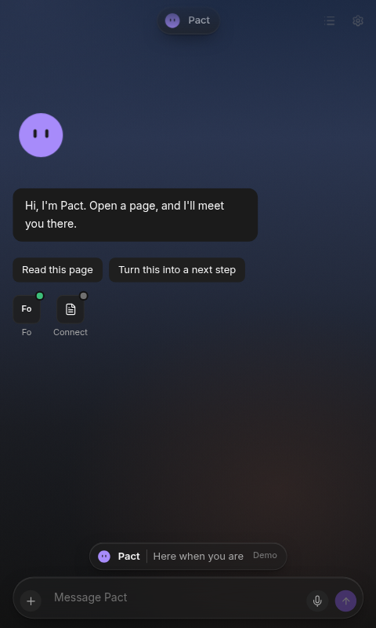

# Pact

A little intention. A real next step.

Pact is a Chrome side panel. Read a page when you choose and talk it through. A research or connect request in your own words can go to Fo directly. Booking, sending, and anything Pact suggests on its own wait until you approve.



## Demo on your machine

Node 20 or newer, and pnpm.

```sh
pnpm install --frozen-lockfile
pnpm --filter backend dev
```

In another terminal:

```sh
pnpm dev
```

`pnpm dev` talks to `http://localhost:3000`. Production builds read `WXT_PUBLIC_PACT_API` from `.env.production`. `pnpm build` and `pnpm zip:release` preserve that hosted origin.

For a compiled judge candidate with an illustrated guide: run `node scripts/package-judges.mjs` after the production build. See `docs/FUNCTIONALITY-HANDOFF.md` for verification and release limits.

Load `.output/chrome-mv3` from `chrome://extensions` with Developer mode on. Open an ordinary webpage and click the Pact icon.

The backend starts in demo mode when you set both of these:

```sh
PACT_AI=mock FO_MODE=mock pnpm --filter backend dev
```

Mocks are refused when `VERCEL_ENV=production`.

For a live Claude reply, leave `PACT_AI` unset and put your key only on the backend:

```sh
ANTHROPIC_API_KEY=your_key ANTHROPIC_MODEL=claude-sonnet-5-5 pnpm --filter backend dev
```

Fo sign-in is **Settings → Connections → Connect Fo**. The local callback is `http://localhost:3000/api/fo/callback`. Tokens stay encrypted under `backend/.local/`.

## Deploy the backend on Vercel

The app Vercel builds is `backend/` (Next.js App Router). `pnpm --filter backend build` runs `next build`.

1. Import this GitHub repo in Vercel.
2. Set **Root Directory** to `backend`. Framework preset: **Next.js**. Build command: `next build` (the `build` script). Leave the output as the Next.js default.
3. Create a Redis database in [Upstash](https://upstash.com) (or the Vercel Marketplace Upstash integration) and copy its **REST URL** and **REST token**. Production stores install tokens, Fo sessions, and rate limits there. The filesystem store is only for a local machine.
4. Add these environment variables for Production. Names match `backend/.env.example`. Do not commit the values.

| Name | Value |
| --- | --- |
| `INSTALL_TOKEN_SECRET` | Long random string. `openssl rand -base64 32` |
| `FO_TOKEN_ENC_KEY` | `openssl rand -base64 32`. It must decode to exactly 32 bytes. |
| `ANTHROPIC_API_KEY` | Claude API key used for live replies |
| `ANTHROPIC_MODEL` | `claude-sonnet-5-5` |
| `PUBLIC_BASE_URL` | `https://pact-nine-lyart.vercel.app` |
| `ALLOWED_EXTENSION_IDS` | `iogfficoaeonclfkgdjfgfdiofdjcbnn` |
| `UPSTASH_REDIS_REST_URL` | Upstash REST URL. `KV_REST_API_URL` works as the same value |
| `UPSTASH_REDIS_REST_TOKEN` | Upstash REST token. `KV_REST_API_TOKEN` works as the same value |

Leave `PACT_AI` and `FO_MODE` unset. Vercel sets `VERCEL_ENV=production`, and that environment refuses mocks. Leave `PACT_FO_CONSEQUENTIAL` unset so Pact only proposes `ask_fo` and Fo reads.

5. Deploy.

The Fo OAuth callback is exactly:

`https://pact-nine-lyart.vercel.app/api/fo/callback`

That is `${PUBLIC_BASE_URL}/api/fo/callback`. Fo redirects the browser there after **Connect Fo**. `PUBLIC_BASE_URL` and this callback must be the same host.

`.env.production` sets `WXT_PUBLIC_PACT_API=https://pact-nine-lyart.vercel.app`. `pnpm zip:release` reads that file and bakes the URL into the extension. `pnpm dev` and `pnpm build` stay on localhost.

## Extension for judges

```sh
pnpm zip:release
```

Unzip the file in `.output/` and follow [INSTALL.md](INSTALL.md). That build talks to the production URL in `.env.production`. The manifest key stays so the extension id matches the backend allow list.

`pnpm zip` is the store build. It strips the key.

## Verify

```sh
pnpm install --frozen-lockfile
pnpm -r check
pnpm -r test
pnpm build
pnpm --filter backend build
```

See [PACT.md](PACT.md), [docs/DESIGN-SOURCE.md](docs/DESIGN-SOURCE.md), and [FO-INTEGRATION.md](FO-INTEGRATION.md).
